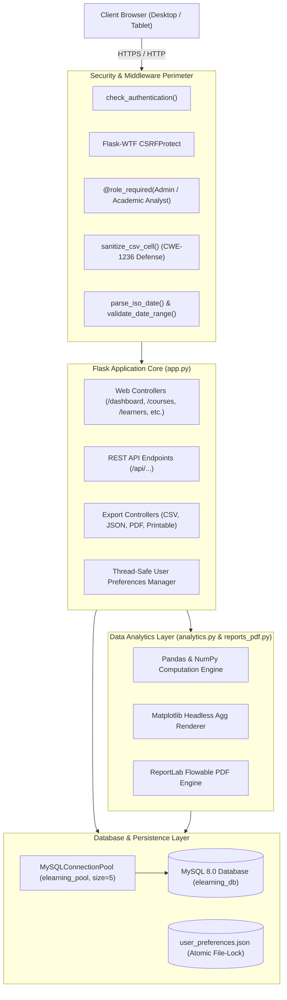
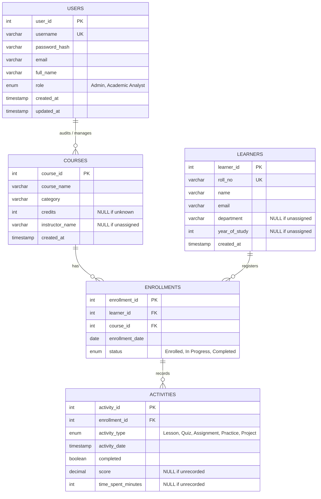

# 🎓 E-Learning Course Analytics System

A production-grade, enterprise-hardened analytics platform built with **Python Flask**, **MySQL 8.0**, **Pandas**, **NumPy**, **Matplotlib**, **ReportLab**, **Bootstrap 5**, and **Chart.js**. Designed for academic institutions and universities to monitor student learning trajectories, course completion metrics, engagement trends, and inactive enrollments with granular role-based access control, CSRF defense, CWE-1236 CSV sanitization, and multi-format document exporting.

---

## 📋 Table of Contents
1. [Project Overview](#-project-overview)
2. [Key Capabilities & Enterprise Features](#-key-capabilities--enterprise-features)
3. [Technology Stack](#-technology-stack)
4. [Architecture & System Design](#-architecture--system-design)
   - [Application Architecture](#application-architecture)
   - [Entity-Relationship Diagram (ERD)](#entity-relationship-diagram-erd)
   - [Role-Based Access Control (RBAC) Matrix](#role-based-access-control-rbac-matrix)
   - [Security Architecture & Defensive Hardening](#security-architecture--defensive-hardening)
5. [Folder Structure](#-folder-structure)
6. [Prerequisites & Environment Setup](#-prerequisites--environment-setup)
7. [Step-by-Step Installation Guide](#-step-by-step-installation-guide)
   - [Step 1: Open Project in VS Code](#step-1-open-the-project-in-vs-code)
   - [Step 2: MySQL Database Initialization](#step-2-mysql-database-initialization)
   - [Step 3: Environment Configuration (.env)](#step-3-environment-configuration-env)
   - [Step 4: Virtual Environment & Dependencies](#step-4-virtual-environment--dependencies)
   - [Step 5: Start the Server (Dev vs Production)](#step-5-start-the-server-dev-vs-production)
8. [Default Demonstration Accounts](#-default-demonstration-accounts)
9. [User Guide & Feature Walkthrough](#-user-guide--feature-walkthrough)
   - [Unified Filter Toolbar & Date Presets](#unified-filter-toolbar--date-presets)
   - [Score & Study-Duration Trends (Honest Empty States)](#score--study-duration-trends-honest-empty-states)
   - [Learner & Course Management](#learner--course-management)
   - [Multi-Format Reporting Engine (CSV, JSON, PDF, Printable)](#multi-format-reporting-engine-csv-json-pdf-printable)
   - [User Preferences Persistence](#user-preferences-persistence)
10. [REST API & Export Route Specification](#-rest-api--export-route-specification)
11. [Automated Verification & Audit Test Suites](#-automated-verification--audit-test-suites)
12. [Troubleshooting & FAQ](#-troubleshooting--faq)
13. [Academic Project Compliance & Invariants](#-academic-project-compliance--invariants)

---

## 🌟 Project Overview

The **E-Learning Course Analytics System** delivers real-time visibility into educational operations. Built specifically to eliminate fragmented spreadsheets and unverified reporting, it provides academic directors, department heads, and course analysts with reliable intelligence backed by relational database integrity:

- **Strict Data Integrity**: Strictly preserves all authentic records; no synthetic students, fabricated scores, or simulated telemetry.
- **Null-Safe Analytics**: Properly differentiates between genuine zero scores and unrecorded (`NULL`) telemetry, preventing misleading averages.
- **End-to-End Security**: Protected against Cross-Site Request Forgery (CSRF), CSV Formula Injection (CWE-1236), SQL Injection, and Unauthorized Role Escalation.
- **Enterprise Reporting**: Exports 6 distinct operational reports across 4 delivery formats (Streaming CSV, RESTful JSON, Paginated Vector PDF, and High-Contrast Printable HTML).

---

## 🚀 Key Capabilities & Enterprise Features

1. **Course & Curriculum Management**: Full lifecycle management with category classification, nullable credit allocations, instructor assignment, and safe deletion guards that prevent orphan foreign key references.
2. **Learner Progression Directory**: Unique college roll number tracking, department segregation, year-of-study categorization, and per-learner completion progress tracking.
3. **Enrollment Tracking**: Progression state tracking (`Enrolled`, `In Progress`, `Completed`) with timestamped audit trails and duplicate enrollment locks.
4. **Learning Activity Audit**: Granular tracking across activity types (`Lesson`, `Quiz`, `Assignment`, `Practice`, `Project`) with completion toggles, nullable score inputs, and time-spent metrics.
5. **Dynamic Dashboard Analytics**:
   - Platform KPIs (Total Courses, Active Learners, Enrollments, Inactivity Rate).
   - Course Completion Breakdown without false cross-course averaging.
   - Weekly Activity Aggregations resampled chronologically using Pandas.
   - Dynamic Inactive Learner Detection based on rolling activity windows (default: 14 days, configurable).
6. **Multi-Format Export Suite**:
   - **RFC 4180 CSV**: With CWE-1236 formula sanitization protecting spreadsheet applications.
   - **RESTful JSON**: Machine-readable payload for external API integrations.
   - **Vector PDF**: Generated via ReportLab with two-pass page numbering ("Page X of Y"), auto-wrapping tables, KPI summary cards, and embedded Matplotlib figures.
   - **Printable HTML**: Dedicated, clean `@media print` styled document views with print triggers.

---

## 🛠 Technology Stack

| Layer | Technology | Details |
| :--- | :--- | :--- |
| **Backend Framework** | Python 3.10+, Flask 3.0+ | Lightweight WSGI web application framework & REST API |
| **Production WSGI** | Waitress 3.0+ | Multi-threaded pure-Python WSGI server for Windows & Linux |
| **Database** | MySQL Server 8.0+ | Relational InnoDB engine, utf8mb4 collation, Connection Pooling |
| **Data Engine** | Pandas & NumPy | High-performance vector math, time-series resampling, and aggregation |
| **Chart Engines** | Chart.js 4.4 & Matplotlib | Interactive frontend canvas charts & server-side headless vector plots |
| **PDF Engine** | ReportLab 4.2+ | Flowable documents, canvas two-pass pagination, automated table wrapping |
| **Security & Auth** | Flask-WTF, bcrypt, itsdangerous | CSRF token protection, salted password hashing, hardened session cookies |
| **Frontend UI** | Bootstrap 5.3, Bootstrap Icons | Responsive UI, high-contrast dark/light themes, accessible modal dialogs |

---

## 🏗 Architecture & System Design

### Application Architecture



### Entity-Relationship Diagram (ERD)



### Role-Based Access Control (RBAC) Matrix

| Operation / Feature | Anonymous User | Academic Analyst | Admin |
| :--- | :---: | :---: | :---: |
| **View Login Page / Authenticate** | ✅ Allowed | ✅ Allowed | ✅ Allowed |
| **View Analytics Dashboard & KPIs** | ❌ Blocked (302) | ✅ Allowed | ✅ Allowed |
| **Filter Dashboard by Course & Dates** | ❌ Blocked (401) | ✅ Allowed | ✅ Allowed |
| **View Course, Learner & Activity Logs** | ❌ Blocked (302) | ✅ Allowed | ✅ Allowed |
| **Download Reports (CSV, JSON, PDF, Printable)** | ❌ Blocked (401/302) | ✅ Allowed | ✅ Allowed |
| **Generate Matplotlib Server Charts** | ❌ Blocked (401) | ✅ Allowed | ✅ Allowed |
| **Update Own Profile & Theme Preferences** | ❌ Blocked (401) | ✅ Allowed | ✅ Allowed |
| **Create / Edit / Delete Courses** | ❌ Blocked (401) | ❌ Forbidden (403) | ✅ Allowed |
| **Create / Edit / Delete Learners** | ❌ Blocked (401) | ❌ Forbidden (403) | ✅ Allowed |
| **Create / Edit Enrollments** | ❌ Blocked (401) | ❌ Forbidden (403) | ✅ Allowed |
| **Log Learning Activities** | ❌ Blocked (401) | ❌ Forbidden (403) | ✅ Allowed |

### Security Architecture & Defensive Hardening

1. **CSRF Protection (Flask-WTF)**:
   - All state-changing HTTP requests (`POST`, `PUT`, `DELETE`) require a cryptographically valid CSRF token.
   - Frontend JavaScript automatically injects the `X-CSRFToken` header from the meta tag into all `fetch()` operations.
2. **CSV Formula Injection Defense (CWE-1236)**:
   - Untrusted strings starting with formula trigger characters (`=`, `+`, `-`, `@`, `\t`, `\r`, `\n`) or combinations of leading whitespace are prefixed with a single quote (`'`).
   - Legitimate numeric values (such as integer negative numbers `-42` or floats `-3.14`) are strictly preserved as numeric data types and never incorrectly escaped.
3. **Session Cookie Hardening**:
   - `SESSION_COOKIE_HTTPONLY = True`: Blocks JavaScript access to session tokens, neutralizing Cross-Site Scripting (XSS) session theft.
   - `SESSION_COOKIE_SAMESITE = 'Lax'`: Prevents Cross-Site Request Forgery token leakage.
   - `SESSION_COOKIE_SECURE = True`: Automatically activated in production HTTPS environments.
4. **Input Sanitization & ISO Date Validation**:
   - Date query parameters (`start_date`, `end_date`) are strictly parsed using ISO-8601 regex and calendar date validation (`parse_iso_date`).
   - Malformed dates or inverted ranges (`start_date > end_date`) return clear HTTP `400 Bad Request` responses before SQL execution.
5. **Concurrency & File Isolation**:
   - User preferences are isolated by user ID and written atomically using `threading.Lock()` and atomic `os.replace` on `.tmp` files to prevent write corruption under high load.

---

## 📁 Folder Structure

```
elearning_analytics/
│
├── app.py                     # Core Flask application, RBAC decorators & routing
├── config.py                  # Database pooling, environment configuration & credentials
├── analytics.py               # Pandas/NumPy analytics engine & Matplotlib headless plots
├── reports_pdf.py             # Enterprise ReportLab PDF document generator
├── wsgi.py                    # Multi-threaded Waitress WSGI production entrypoint
├── database.sql               # MySQL 8.0 idempotent schema DDL & verified baseline records
├── requirements.txt           # Python dependencies specification
├── .env.example               # Environment variables configuration template
├── .gitignore                 # Excludes .env, backups, caches, and exports
├── README.md                  # Comprehensive technical documentation
│
├── templates/                 # Responsive Jinja2 HTML5 templates
│   ├── base.html              # Master layout, navigation bar, CSRF meta tag & modal framework
│   ├── index.html             # Analytics dashboard with Chart.js canvases & filter toolbar
│   ├── home.html              # Platform landing page
│   ├── login.html             # Secure user login interface
│   ├── profile.html           # User profile editor & theme preference controls
│   ├── courses.html           # Course catalog & administrative modal CRUD
│   ├── learners.html          # Learner directory & progress drilldown modal
│   ├── enrollments.html       # Enrollment registry & status tracking
│   ├── activities.html        # Learning activity logger & timestamp filter
│   ├── reports.html           # 6 Analytical report tabs with 4-way export controls
│   └── printable_report.html  # High-contrast printable document layout (@media print)
│
├── static/                    # Frontend assets
│   ├── css/
│   │   └── style.css          # Modern dashboard stylesheet & high-contrast themes
│   ├── js/
│   │   ├── dashboard.js       # Live KPI loading, date presets & Chart.js rendering
│   │   ├── courses.js         # Course catalog management & modal workflows
│   │   ├── learners.js        # Learner registration, search & progress inspection
│   │   ├── enrollments.js     # Enrollment manager & status transitions
│   │   ├── activities.js      # Learning activity logging & completion toggles
│   │   └── reports.js         # Analytical report switching & synchronized export URL handling
│   └── charts/                # Generated server-side Matplotlib chart artifacts
│
├── backups/                   # Point-in-time idempotent SQL database backups
└── scratch/                   # Automated audit & end-to-end verification test suites
    ├── audit_phase6_checklist.py  # Deep verification audit (CWE-1236, dates, exports, prefs)
    └── test_phase7_e2e.py         # Full end-to-end lifecycle test suite (100% pass)
```

---

## ⚙ Prerequisites & Environment Setup

Verify the following tools are installed on your Windows development environment:

1. **Python 3.10, 3.11, or 3.12**:
   - Download from [python.org](https://www.python.org/downloads/).
   - ⚠️ **Ensure `Add python.exe to PATH` is checked during installation.**
2. **MySQL Server 8.0+ & MySQL Workbench**:
   - Download from [dev.mysql.com](https://dev.mysql.com/downloads/installer/).
   - Set up `root` user with your chosen administrative password.
   - Ensure the `MySQL80` service is running in Windows Services (`services.msc`).
3. **Visual Studio Code**:
   - Recommended editor with Python and PowerShell extensions.

---

## 🚀 Step-by-Step Installation Guide

### Step 1: Open the Project in VS Code
1. Open VS Code.
2. Select **File &rarr; Open Folder...** and select `C:\Users\surug\.gemini\antigravity\scratch\elearning_analytics`.
3. Open the integrated terminal (`Ctrl + ~`).

### Step 2: MySQL Database Initialization
1. Launch **MySQL Workbench** and connect to your local MySQL instance.
2. Open `database.sql` from the project directory.
3. Execute the script (`Ctrl + Shift + Enter`).
4. Refresh your Schemas. The `elearning_db` database is created with 5 fully verified tables (`users`, `courses`, `learners`, `enrollments`, `activities`).

### Step 3: Environment Configuration (.env)
1. Copy `.env.example` to create `.env`:
   ```powershell
   Copy-Item .env.example .env
   ```
2. Open `.env` and configure your credentials:
   ```ini
   DB_HOST=127.0.0.1
   DB_PORT=3306
   DB_USER=root
   DB_PASSWORD=your_mysql_password
   DB_NAME=elearning_db

   FLASK_PORT=5000
   FLASK_DEBUG=False
   SECRET_KEY=college-project-production-secret-key-2026-secure

   WAITRESS_HOST=0.0.0.0
   WAITRESS_PORT=5000
   WAITRESS_THREADS=6
   INACTIVITY_DAYS_THRESHOLD=14
   ```

### Step 4: Virtual Environment & Dependencies
1. Create and activate a Python virtual environment:
   ```powershell
   python -m venv venv
   .\venv\Scripts\Activate.ps1
   ```
2. Install required packages:
   ```powershell
   python -m pip install --upgrade pip
   python -m pip install -r requirements.txt
   ```

### Step 5: Start the Server (Dev vs Production)

#### Option A: Production WSGI Server (Recommended)
Run the Waitress multi-threaded production server:
```powershell
python wsgi.py
```
*Output:*
```text
======================================================================
  Starting E-Learning Course Analytics System (Production WSGI)
  Serving on: http://0.0.0.0:5000
  Worker Threads: 6
======================================================================
```

#### Option B: Flask Development Server
For local debugging with automatic reload:
```powershell
python app.py
```

Access the application in your browser at: **`http://127.0.0.1:5000`**

---

## 🔑 Default Demonstration Accounts

The database comes pre-configured with two verified roles for demonstration:

| Username | Password | Role | Access Scope |
| :--- | :--- | :--- | :--- |
| **`admin`** | `admin123` | **Admin** | Full system control: Course & Learner CRUD, enrollment editing, activity logging, profile management, and all analytics exports. |
| **`aturing`** | `password123` | **Academic Analyst** | Read-only analytics: Dashboard KPI filtering, Chart.js trends, backend Matplotlib generation, and all 24 multi-format report exports. |

---

## 🖥 User Guide & Feature Walkthrough

### Unified Filter Toolbar & Date Presets
The analytics dashboard features an interactive filter toolbar:
- **Preset Quick-Selectors**: *Today*, *Last 7 Days*, *Last 30 Days*, *This Quarter*, *All Time*.
- **Course Selector**: Dynamic filtering scoped to a single course or platform-wide aggregated metrics.
- **Custom Date Pickers**: Native HTML5 date pickers with client-side validation preventing inverted ranges.
- **Sync with URL Query Strings**: Filter states synchronize seamlessly into export URLs across all reports.

### Score & Study-Duration Trends (Honest Empty States)
- Differentiates unrecorded telemetry from zero scores.
- When `score` or `time_spent_minutes` are `NULL` in the database, the dashboard displays an informative, honest notification card rather than falsifying zero averages or fabricating student grades.

### Learner & Course Management
- **Learners (`/learners`)**: Search by roll number or name, filter by department, inspect enrolled courses, view individual course progress percentages, and register new learners.
- **Courses (`/courses`)**: Add new curriculum entries with department classification and credits. Safe deletion controls reject deletion requests if active student enrollments exist.

### Multi-Format Reporting Engine (CSV, JSON, PDF, Printable)
Each of the 6 analytical modules provides a 4-way export dropdown:
1. **Course Completion Analysis** (`/reports` &rarr; Tab 1)
2. **Course Comparison Breakdown** (`/reports` &rarr; Tab 2)
3. **Learner Performance Tracking** (`/reports` &rarr; Tab 3)
4. **Activity Participation Metrics** (`/reports` &rarr; Tab 4)
5. **Weekly Activity Trends** (`/reports` &rarr; Tab 5)
6. **Inactive Enrollment Risk Report** (`/reports` &rarr; Tab 6)

### User Preferences Persistence
- Users can customize their experience via the profile settings (`/profile`):
  - **Theme**: Light Mode / Dark Mode.
  - **Default Page Size**: 10, 25, 50, or 100 rows.
  - **Default Date Preset**: Automatically applied to dashboard on login.
- Preferences are written to `user_preferences.json` with file-locking to ensure multi-user isolation.

---

## 📡 REST API & Export Route Specification

### Authentication & User Preferences
- `POST /login` — Authenticate user and initiate secure session (requires CSRF token).
- `POST /logout` — Terminate session.
- `GET /profile` — View user profile.
- `POST /profile` — Update username, full name, or email.
- `GET /api/user/preferences` — Fetch current user UI preferences.
- `PUT /api/user/preferences` — Update UI theme, page size, and date presets (requires CSRF token).

### System Diagnostics & Health
- `GET /api/health` — Returns system health and MySQL connection pool status.
- `GET /api/csrf-token` — Returns a fresh CSRF token for asynchronous client requests.

### Dashboard & Analytics Endpoints
- `GET /api/dashboard/summary?course_id=...&start_date=...&end_date=...` — Real-time overview KPIs.
- `GET /api/analytics/course-completion` — Course completion distributions for Chart.js.
- `GET /api/analytics/weekly-activity?start_date=...&end_date=...` — Time-series weekly activity counts.
- `GET /api/analytics/activity-participation?course_id=...` — Completion percentage by activity type.
- `GET /api/analytics/score-time-trends?course_id=...` — Performance score and duration trends.
- `GET /api/analytics/inactive-enrollments?threshold=14` — Filtered inactive enrollment list.
- `POST /api/reports/generate-charts` — Generates high-resolution Matplotlib PNG charts into `static/charts/`.

### Administrative CRUD Endpoints (Admin Role Required)
- `GET /api/courses` & `POST /api/courses` — Search catalog or create course.
- `PUT /api/courses/<id>` & `DELETE /api/courses/<id>` — Modify or safely delete course.
- `GET /api/learners` & `POST /api/learners` — List learners or register new student.
- `PUT /api/learners/<id>` & `DELETE /api/learners/<id>` — Update roll number or remove learner.
- `GET /api/learners/<id>/progress` — Calculate progress percentages for a learner.
- `GET /api/enrollments` & `POST /api/enrollments` — List or create enrollments.
- `PUT /api/enrollments/<id>` — Update enrollment status (`Enrolled`, `In Progress`, `Completed`).
- `GET /api/activities` & `POST /api/activities` — Log activity or query activity audit log.

### Multi-Format Export Matrix (24 Endpoints)

| Analytical Module | CSV Format (CWE-1236 Sanitized) | JSON Format (REST API) | PDF Format (ReportLab Engine) | Printable HTML Format (@media print) |
| :--- | :--- | :--- | :--- | :--- |
| **Course Completion** | `GET /api/reports/course-completion.csv` | `GET /api/reports/course-completion.json` | `GET /api/reports/course-completion.pdf` | `GET /reports/printable/course-completion` |
| **Course Comparison** | `GET /api/reports/course-comparison.csv` | `GET /api/reports/course-comparison.json` | `GET /api/reports/course-comparison.pdf` | `GET /reports/printable/course-comparison` |
| **Learner Performance** | `GET /api/reports/learner-performance.csv` | `GET /api/reports/learner-performance.json` | `GET /api/reports/learner-performance.pdf` | `GET /reports/printable/learner-performance` |
| **Activity Participation** | `GET /api/reports/activity-participation.csv` | `GET /api/reports/activity-participation.json` | `GET /api/reports/activity-participation.pdf` | `GET /reports/printable/activity-participation` |
| **Weekly Trends** | `GET /api/reports/weekly-activity.csv` | `GET /api/reports/weekly-activity.json` | `GET /api/reports/weekly-activity.pdf` | `GET /reports/printable/weekly-activity` |
| **Inactive Enrollments**| `GET /api/reports/inactive-enrollments.csv` | `GET /api/reports/inactive-enrollments.json` | `GET /api/reports/inactive-enrollments.pdf` | `GET /reports/printable/inactive-enrollments` |

---

## 🧪 Automated Verification & Audit Test Suites

The codebase includes automated test suites to verify security controls, RBAC enforcement, export integrity, and database invariants:

### 1. Phase 6 Security & Validation Audit
Verifies CSV formula neutralization, ISO date range validation, PDF edge-case wrapping, printable HTML layouts, user preference concurrency, and production environment configurations:
```powershell
python scratch/audit_phase6_checklist.py
```
*Expected Result: 100% PASS across all 6 audit items.*

### 2. Phase 7 Complete End-to-End System Validation
Tests the full user lifecycle (login &rarr; RBAC check &rarr; CSRF validation &rarr; dashboard KPI calculation &rarr; all 24 export endpoints &rarr; profile/preferences &rarr; database invariant preservation):
```powershell
python scratch/test_phase7_e2e.py
```
*Expected Result: 100% PASS across all 8 end-to-end test blocks.*

---

## 🔧 Troubleshooting & FAQ

### 1. `ModuleNotFoundError: No module named 'reportlab'` (or `'waitress'`, `'flask_wtf'`)
- **Cause:** Virtual environment is not activated or dependencies are not installed.
- **Fix:**
  ```powershell
  .\venv\Scripts\Activate.ps1
  python -m pip install -r requirements.txt
  ```

### 2. MySQL `Access denied for user 'root'@'localhost'`
- **Cause:** Incorrect database password in your local `.env`.
- **Fix:** Update `DB_PASSWORD` in `.env` to match your local MySQL root password.

### 3. `CSRF token missing or incorrect`
- **Cause:** Submitting an AJAX or API request without passing the `X-CSRFToken` header.
- **Fix:** Fetch a fresh token via `GET /api/csrf-token` or read it from `<meta name="csrf-token" content="...">`.

### 4. `Port 5000 is already in use`
- **Cause:** A previous instance of Python or Waitress is still running in the background.
- **Fix:** Stop the occupying process in PowerShell:
  ```powershell
  Stop-Process -Id (Get-NetTCPConnection -LocalPort 5000).OwningProcess -Force
  ```

---

## 📊 Academic Project Compliance & Invariants

This system is engineered under strict verification constraints:
- **Baseline Invariant Counts**: Exactly **4 users**, **10 courses**, **11 learners**, **13 enrollments**, and **29 activities**.
- **No Fabricated Telemetry**: Activity scores and time-spent metrics remain strictly `NULL` for historical demonstration records where telemetry was unrecorded.
- **Idempotency**: All database migration and schema update scripts verify existing metadata before applying changes, ensuring zero data loss upon re-execution.
